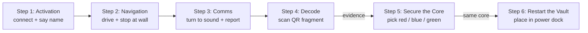
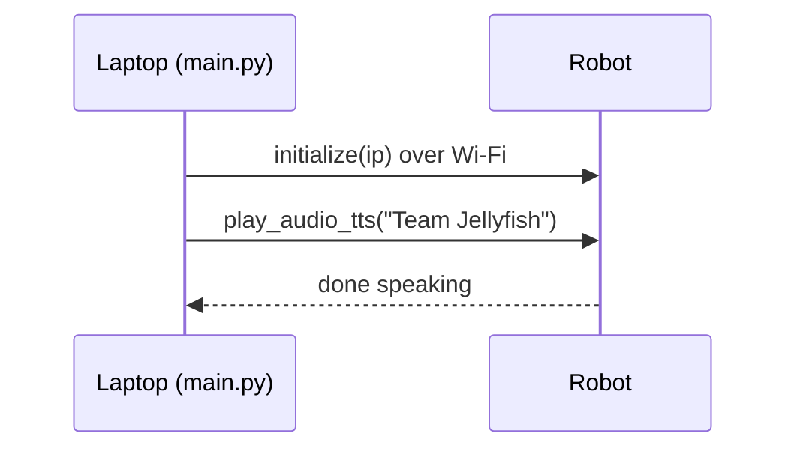
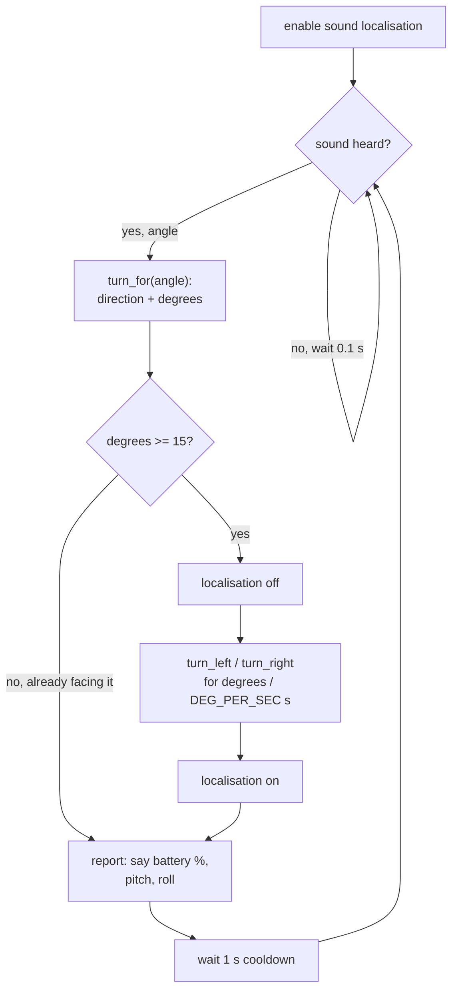
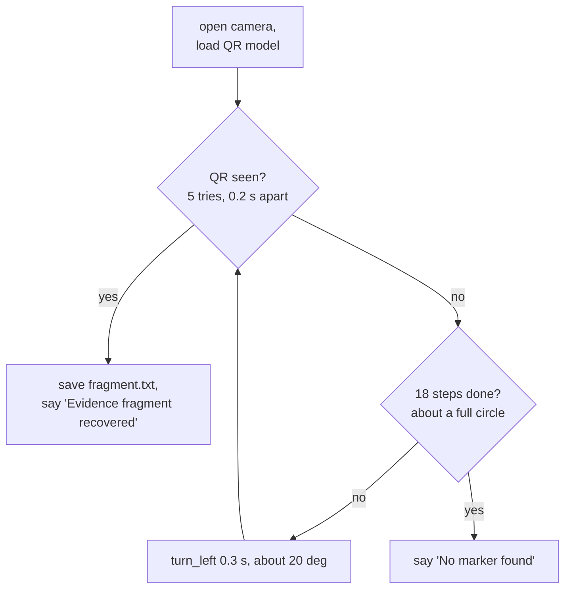

# Our solutions, checkpoint by checkpoint

Everything talks to the robot through the `ugot` Python SDK (pinned to 0.2.9, see `requirements.txt`).
Run a task with `python main.py <task> --ip <robot-ip>`.

| Checkpoint | Status | Code |
|---|---|---|
| 1. Emergency Activation | Done | `main.py` (`hello`) |
| 2. Navigation Calibration | Not built yet | - |
| 3. Communications Recovery | Done, turn angle needs calibrating | `tasks/sound_turn.py`, `motion.py` |
| 4. Decode the Energy Signature | Scan done, decrypting not built | `qr_scan.py`, `read_qr.py` |
| 5. Secure the Core | Not built yet | - |
| 6. Restart the Vault | Not built yet | - |

How the checkpoints connect: the evidence from 4 decides the core in 5, and the same core restarts the vault in 6.



## Shared: our own motion layer (`motion.py`)

The SDK's chassis turns (`mecanum_turn_speed_times` etc.) did nothing on our build, so we drive the four wheel motors ourselves:

| Motor ID | Wheel |
|---|---|
| 11 | front left |
| 41 | front right |
| 31 | back left |
| 61 | back right |

```
              FRONT
     11 [FL] ======== [FR] 41
          |            |
          |   robot    |
          |            |
     31 [BL] ======== [BR] 61
              BACK

 turn_left : left side (11, 31) backward, right side (41, 61) forward
 turn_right: left side forward,  right side backward
```

- `drive(got, left, right)` sets the left pair (11, 31) and the right pair (41, 61) with `turn_motor_speed`. The left side is mirror-mounted, so its speed is negated (`LEFT_SIGN = -1`).
- `forward`, `turn_left`, `turn_right` run `drive` for a number of seconds, then `stop`.
- Turning in place = left and right sides spinning in opposite directions.
- Turns are timed, not measured: the IMU yaw doesn't change on our robot, so we can't stop on a heading. `DEG_PER_SEC` converts degrees to seconds. It is still a guess (90 at speed 40); calibrate it by timing `turn_left(got, 2)` and setting it to the degrees turned / 2.

## 1. Emergency Activation

**Goal:** robot assembled, connected to the laptop, says the team name.

**Logic:** `main.py` connects with `got.initialize(ip)` over Wi-Fi. The `hello` task then calls `got.play_audio_tts("Team Jellyfish", 0, True)`, which speaks the name on the robot's speaker and waits until it finishes.

```
python main.py hello --ip <robot-ip>
```



## 2. Navigation Calibration

**Goal:** drive the marked route into the bay, stop 15-25 cm from the wall using the distance sensor.

**Status:** not built yet. Planned approach: drive forward with `motion.drive`, poll the distance sensor, and call `motion.stop` once the reading is inside 15-25 cm, aiming for the middle (~20 cm) so we stop inside the window.

## 3. Communications Recovery

**Goal:** turn towards a voice or clap, then report battery level and tilt.

**Logic (`tasks/sound_turn.py`):**

Mic angles, seen from above:

```
                 90  (front)
                  ^
                  |
  180 (left) <- robot -> 0 (right)
                  |
                  v
                 270 (back)

  delta = angle - 90, wrapped to -180..180
  e.g. 180 -> delta +90  -> turn left 90
       0   -> delta -90  -> turn right 90
       300 -> delta -150 -> turn right 150
```



1. `got.enable_audio_direction()` turns on the mic array's sound localisation.
2. Loop: `got.AUDIO.getDirectionOfAudio()` returns the raw angle of the last sound. We use the raw angle because the SDK's `get_audio_direction()` only gives Front/Left/Right/Back.
3. `turn_for(angle)` converts it to a turn. The mic reports 90° = straight ahead, counter-clockwise, so `delta = angle - 90` wrapped to -180..180: positive means turn left, negative means turn right, and `abs(delta)` is how far to turn.
4. Turns under 15° (`min_angle`) are skipped, since the sound is already roughly in front.
5. Sound localisation is switched off while turning, then back on. With it on, the robot didn't drive its motors, and it also stops motor noise from being heard as a new sound.
6. The turn is `motion.turn_left`/`turn_right` for `degrees / DEG_PER_SEC` seconds.
7. `report(got)` reads `get_power_status()` (battery %) and `read_gyro_data()` (pitch, roll = tilt), prints them and speaks them.
8. Wait 1 s (`cooldown`) so our own speech isn't picked up as the next sound.

```
python main.py sound-turn --ip <robot-ip> [--speed 40]
python -m tasks.sound_turn     # self-test of the angle math, no robot needed
```

**Known limits:** turn size depends on `DEG_PER_SEC` being calibrated. Tilt comes from the same IMU whose yaw doesn't work, so check pitch/roll look sensible.

## 4. Decode the Energy Signature

**Goal:** find our marker, scan its QR code, recover the encrypted evidence fragment.

**Logic (`qr_scan.py`):**



1. Open the camera and load the `apriltag_qrcode` vision model.
2. Search by spinning: up to 18 steps of `turn_left` for 0.3 s (~20° each, about one full turn).
3. At each step, try `get_qrcode_total_info()` up to 5 times, 0.2 s apart, and take the first result with text.
4. On a hit: print it, save it to `fragment.txt`, say "Evidence fragment recovered". If the full turn finds nothing, say "No marker found".
5. Release the model.

`read_qr.py` is the stand-still version: it polls both the QR and QR+AprilTag readers 30 times, for when the marker is already in view.

```
python qr_scan.py <robot-ip>
```

**Not built yet:** decrypting the fragment. The raw text is saved in `fragment.txt` for that step.

## 5. Secure the Core

**Goal:** choose red, blue or green from the evidence, collect that core, put it in our containment chest.

**Status:** not built yet. It depends on decrypting the fragment from checkpoint 4 to choose the colour.

## 6. Restart the Vault

**Goal:** carry the chosen core to the restart station and place it in the power dock; the app announces success or failure.

**Status:** not built yet. Once it is, add here how the evidence identified the core, since the final reveal asks for that.
